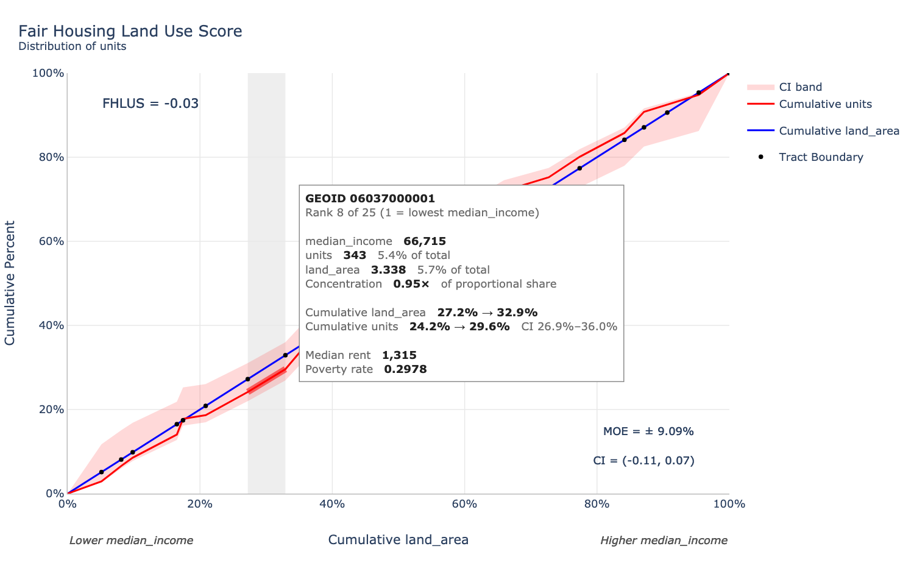
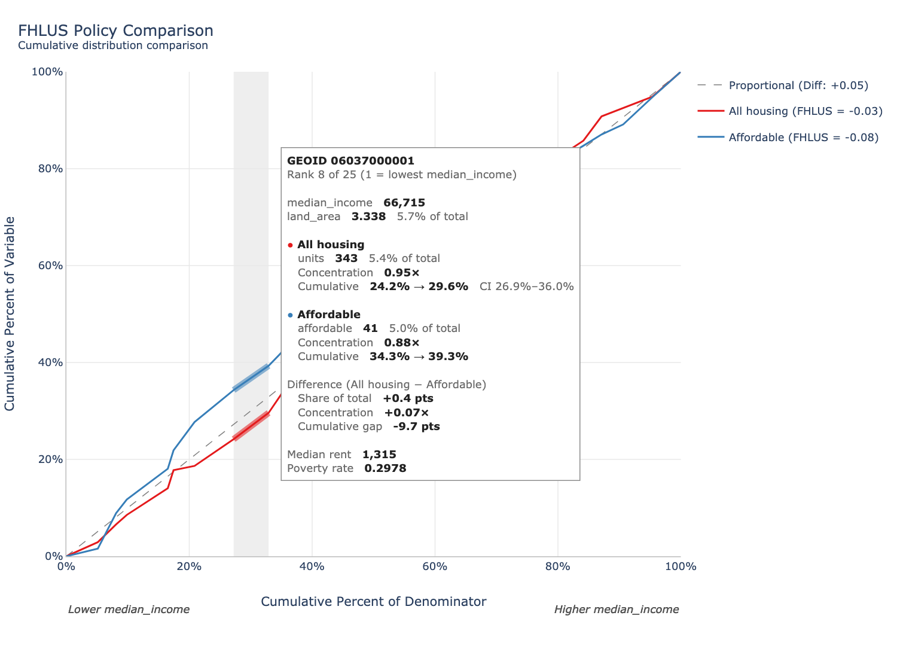

# fhlus: Fair Housing Land Use Score

## Overview

The **fhlus** package calculates the Fair Housing Land Use Score (FHLUS), a statistical measure that analyzes the spatial distribution of housing units (or other variables) across geographic areas ranked by opportunity indicators.

**FHLUS scores range from -1 to +1:**

- **+1.0**: All units concentrated in highest-opportunity areas (ideal)
- **0.0**: Proportional distribution matching area distribution (neutral)
- **-1.0**: All units concentrated in lowest-opportunity areas (concerning)

This tool helps urban planners, housing researchers, and policymakers assess whether affordable housing or other resources are equitably distributed across neighborhoods with varying levels of opportunity.

## Installation

Install the development version from GitHub:

```r
# install.packages("devtools")
devtools::install_github("aaronbarrall/fhlus")
```

## Quick Start

```r
library(fhlus)

# Create sample data
sample_data <- data.frame(
  tract_id = 1:10,
  housing_units = c(100, 150, 200, 120, 180, 90, 160, 140, 110, 130),
  median_income = c(45000, 62000, 38000, 71000, 55000,
                    82000, 48000, 66000, 59000, 74000),
  land_area = c(2.5, 3.1, 1.8, 2.9, 3.5, 2.2, 2.7, 3.3, 2.1, 2.8)
)

# Calculate FHLUS
result <- fhlus_score(
  df = sample_data,
  numerator = "housing_units",  # Variable of interest
  rank_var = "median_income",    # Opportunity indicator (higher = better)
  denom = "land_area"            # Denominator (typically area)
)

# View results
print(result)
result$scores
```

## Function Reference

Every function the package exports, grouped by task. Run `?function_name` for full documentation.

### Calculating scores

| Function | What it does | Key arguments |
|---|---|---|
| `fhlus_score()` | Calculates FHLUS for one dataset and returns the score, AUC, cumulative curve data, plot and metadata. | `df`, `numerator`, `rank_var`, `denom`, `missing` / `missing_pct` (confidence interval), `tie_breaker`, `exclude_area`, `show_ci_bands`, `graph`, `verbose` |
| `grouped_fhlus()` | Calculates FHLUS for every group (e.g., each city), one row per group with `score`, `score_lowest`, `score_highest`. Per-group error rates can come from a column. | `df`, `group_var`, the `fhlus_score()` arguments, `graph_subset`, `parallel` (needs `furrr`) |
| `calculate_multiple_indices()` | Runs FHLUS for several opportunity measures (e.g., income and poverty) at once, optionally by group. Returns long and wide tables. | `data`, `indices` (named list of specs, each can set `ascending = FALSE`), `group_var` |

### Preparing spatial data (requires `sf`)

| Function | What it does | Key arguments |
|---|---|---|
| `prepare_spatial_fhlus()` | One call for the whole spatial pipeline: reproject, clip neighborhoods to a jurisdiction, calculate `total_area` / `excluded_area` / `available_area`, and sum a spatial numerator into the neighborhoods. Prints numbered progress steps and warns when a job looks slow. | `spatial_data`, `area_crs`, `boundary`, `boundary_id`, `min_share`, `numerator`, `numerator_vars`, `numerator_method`, `exclude_zones` / `zone_column`, `exclude_layer`, `outside`, `verbose` |
| `clip_to_boundary()` | Clips neighborhoods (e.g., tracts) to a boundary so only area inside the jurisdiction counts in the denominator. Adds `original_area` and `share_in_boundary`, and drops slivers. With `boundary_id`, clips to several jurisdictions at once and stacks the result. | `neighborhoods`, `boundary`, `boundary_id`, `min_share` |
| `assign_to_neighborhoods()` | Sums a numerator layer (points or polygons) into neighborhoods. Every neighborhood is kept, with 0 where nothing falls. A point on a shared edge is counted once. It reports how much was assigned and what fell outside. | `numerator`, `neighborhoods`, `vars`, `method` (`"point_on_surface"` or `"area_weighted"`), `count_col`, `outside` |
| `aggregate_to_neighborhoods()` | Older interface to `assign_to_neighborhoods()`, kept for existing scripts. Adds `total_units` and `n_sites`. | `units_data`, `neighborhoods`, `unit_var`, `neighborhood_id` |
| `spatial_impute()` | Fills missing values from neighboring features (needs `spdep`). | `spatial_data`, `impute_var`, `method` (`"mean"`, `"median"`, `"idw"`), `k` |
| `validate_fhlus_data()` | Checks a data frame before scoring: missing columns, NAs, negative values, too few rows. | `data`, `numerator`, `rank_var`, `denom` |

### Comparing and analyzing results

| Function | What it does | Key arguments |
|---|---|---|
| `fhlus_compare()` | Overlays two results on one plot (e.g., all housing vs. affordable housing) with labeled scores, their difference, and optional CI ribbons. | `result_a`, `result_b`, `label_a`, `label_b`, `show_ci`, `rank_var` |
| `analyze_grouped_fhlus()` | Joins grouped scores to group characteristics (e.g., city size) and reports correlations. | `grouped_results`, `group_characteristics`, `join_by` |
| `plot_grouped_fhlus()` | Bar chart of grouped scores. | `grouped_results`, `score_col`, `n_groups`, `highlight_groups` |

### Interactive plots (require `plotly` and `htmlwidgets`)

| Function | What it does | Key arguments |
|---|---|---|
| `fhlus_interactive()` | Interactive version of the FHLUS plot. Hovering shows each geography's ID, rank, values, shares, concentration and any extra variables. | `result`, `id`, `tooltip_vars`, `show_ci_bands` |
| `fhlus_compare_interactive()` | Interactive version of `fhlus_compare()`, with one combined pop-up per geography. | `result_a`, `result_b`, `label_a`, `label_b`, `id`, `tooltip_vars`, `show_ci` |
| `fhlus_save_html()` | Saves an interactive plot (or a result directly) as a standalone HTML file. | `x`, `file`, `selfcontained` |
| `fhlus_segments()` | The per-geography table behind the interactive plots, for your own analysis or joining to maps. | `result`, `id`, `tooltip_vars` |

### Exporting

| Function | What it does | Key arguments |
|---|---|---|
| `export_fhlus()` | Writes a result, grouped result or data frame to CSV, Excel (with plot; needs `openxlsx`), JSON (needs `jsonlite`) or RDS. | `results`, `filename`, `format`, `include_plot` |
| `fhlus_to_list()` | Converts a result to plain lists and data frames ready for `jsonlite::toJSON()` (used by the web app). | `result`, `id`, `tooltip_vars` |

### Print methods

`print()` has methods for `fhlus` (score summary and plot), `grouped_fhlus` (summary statistics and top/bottom groups), `fhlus_compare` (both scores and the plot) and `fhlus_segments` (one-line summary and the table).

## Example: Grouped Analysis

```r
# Calculate FHLUS for multiple cities
regional_data <- data.frame(
  city = rep(c("City A", "City B", "City C"), each = 10),
  tract_id = 1:30,
  housing_units = sample(50:200, 30, replace = TRUE),
  median_income = sample(30000:90000, 30, replace = TRUE),
  land_area = runif(30, 1, 5)
)

grouped_results <- grouped_fhlus(
  df = regional_data,
  group_var = "city",
  numerator = "housing_units",
  rank_var = "median_income",
  denom = "land_area"
)

# View results — one row per group with score, score_lowest, score_highest
print(grouped_results)

# Per-group error rates (each city can have a different margin of error)
# regional_data$pct_error <- c(rep(0.05, 10), rep(0.10, 10), rep(0.15, 10))
# grouped_results <- grouped_fhlus(..., missing_pct = "pct_error")

# Visualize
plot_grouped_fhlus(grouped_results, score_col = "score", n_groups = 3)
```

## Example: Confidence Intervals

```r
# With 10% margin of error
result <- fhlus_score(
  df = sample_data,
  numerator = "housing_units",
  rank_var = "median_income",
  denom = "land_area",
  missing_pct = 0.10
)

# View confidence interval
result$confidence_interval
result$scores  # Shows base, lowest, highest scores

# With CI ribbon band on the plot
result <- fhlus_score(
  df = sample_data,
  numerator = "housing_units",
  rank_var = "median_income",
  denom = "land_area",
  missing_pct = 0.10,
  show_ci_bands = TRUE  # Shaded envelope between CI curves
)
```

## Example: Policy Comparison

```r
# Compare two variables (e.g., all housing vs. affordable housing)
result_all <- fhlus_score(sample_data, "housing_units", "median_income",
                          "land_area", missing_pct = 0.10, graph = FALSE)
result_aff <- fhlus_score(sample_data, "affordable_units", "median_income",
                          "land_area", missing_pct = 0.10, graph = FALSE)

# Overlay both curves on one plot
comparison <- fhlus_compare(
  result_all, result_aff,
  label_a = "All Housing",
  label_b = "Affordable Housing",
  show_ci = TRUE,       # CI ribbon bands (optional)
  rank_var = "median_income"
)

comparison$plot        # ggplot object
comparison$scores      # Score table with CI bounds
comparison$difference  # Numeric difference
```

## Interactive Plots

Interactive plots let you explore the FHLUS curve geography by geography. Hover
anywhere on the curve to see a pop-up for the tract (or block group,
neighborhood, ...) under the cursor. The tract's segment of the curve is
highlighted, and its share of the x-axis is shaded. The plots work in the
RStudio/Positron viewer, in R Markdown/Quarto documents and in Shiny apps. You
can also save them as a single HTML file that opens in any web browser, without R.

Requires two optional packages:

```r
install.packages(c("plotly", "htmlwidgets"))
```

For a full walkthrough, see `vignette("interactive-plots", package = "fhlus")`.

### How to read the curve

Geographies are sorted from lowest to highest opportunity (by `rank_var`).
**Each geography is one segment of the red curve**:

- its **width** is the geography's share of the denominator (e.g. its share of
  land area), and
- its **rise** is its share of the numerator (e.g. its share of housing units).

So the slope of a segment is the geography's **concentration**: its share of
units divided by its share of land.

- **1.00×** means proportional.
- **2.00×** means twice its proportional share.
- **0.50×** means half its proportional share.

Steep segments on the right-hand side (high opportunity) push the score up.
Steep segments on the left push it down.

### Single result

```r
library(fhlus)

tracts <- data.frame(
  GEOID         = sprintf("06037%06d", 1:10),
  housing_units = c(100, 150, 200, 120, 180, 90, 160, 140, 110, 130),
  median_income = c(45000, 62000, 38000, 71000, 55000,
                    82000, 48000, 66000, 59000, 74000),
  land_area     = c(2.5, 3.1, 1.8, 2.9, 3.5, 2.2, 2.7, 3.3, 2.1, 2.8),
  median_rent   = c(1400, 1750, 1200, 2100, 1600, 2500, 1350, 1900, 1700, 2200),
  pct_poverty   = c(0.22, 0.12, 0.31, 0.08, 0.15, 0.05, 0.25, 0.10, 0.14, 0.07)
)

result <- fhlus_score(tracts, numerator = "housing_units",
                      rank_var = "median_income", denom = "land_area",
                      missing_pct = 0.10, graph = FALSE)

fhlus_interactive(
  result,
  id = "GEOID",                                   # optional: GEOID is found automatically
  tooltip_vars = c("Median rent"  = "median_rent", # any other columns, with display labels
                   "Poverty rate" = "pct_poverty"),
  show_ci_bands = TRUE
)
```



*(Static illustration of a hovered tract. In the live plot, the pop-up follows
the cursor.)*

The pop-up has four sections:

| Section | Contents |
|---|---|
| Header | Geography ID, and its rank (1 = lowest opportunity) |
| Values | Rank variable(s); numerator and denominator with each one's share of the total; excluded area (if `exclude_area` was used); concentration |
| Cumulative | Where the segment starts and ends on each axis; the CI range (if `missing`/`missing_pct` was used) |
| Extra variables | Each column in `tooltip_vars` |

`tooltip_vars` can be **any column of the data passed to `fhlus_score()`**,
including variables that weren't used for ranking. That lets you see, for
example, rents or demographics alongside the FHLUS curve. Name the elements to
give them readable labels; unnamed elements use the column name.

### Policy comparison

`fhlus_compare_interactive()` is the interactive counterpart to `fhlus_compare()`.
Hovering shows **one combined pop-up** per geography:

```r
tracts$affordable_units <- c(30, 20, 60, 10, 25, 5, 40, 15, 20, 10)

result_all <- fhlus_score(tracts, "housing_units", "median_income", "land_area",
                          missing_pct = 0.10, graph = FALSE)
result_aff <- fhlus_score(tracts, "affordable_units", "median_income", "land_area",
                          graph = FALSE)

fhlus_compare_interactive(
  result_all, result_aff,
  label_a = "All housing", label_b = "Affordable",
  tooltip_vars = c("Median rent" = "median_rent", "Poverty rate" = "pct_poverty")
)
```



- **Shown once:** ID, rank, rank variable, denominator and extra variables.
- **One block per policy:** its value and share of the total, concentration,
  and cumulative share (with the CI if that result has one).
- **Difference (A − B):**
  - *Share of total*: the difference in percentage points.
  - *Concentration*: the difference in concentration.
  - *Cumulative gap*: the vertical distance between the two curves at the end
    of the segment.
- **Highlighting:** the geography is highlighted on both curves.
- **Mismatched results:** if the two results don't share the same geographies
  or denominator, each curve gets its own hover target, and the pop-up is for
  whichever curve is nearest the cursor. A geography missing from one result is
  marked *Not in this result*.

### Saving as HTML

```r
w <- fhlus_interactive(result, tooltip_vars = c("Median rent" = "median_rent"))
fhlus_save_html(w, "fhlus_tracts.html")

# Or straight from a result (extra arguments go to fhlus_interactive())
fhlus_save_html(result, "fhlus_tracts.html", tooltip_vars = "median_rent")
```

The file is fully self-contained (about 4 MB, mostly the plotly library). You
can email it, post it or open it offline. Making a single-file export needs
pandoc, which comes with RStudio, Positron and Quarto. If pandoc isn't found,
`fhlus_save_html()` warns you and writes the supporting files to a
`<name>_files/` folder next to the HTML instead. Keep that folder with the file.

### Options

| Argument | Function | Purpose |
|---|---|---|
| `id` | both | Geography ID column. Default: `GEOID`/`geoid`/`GEOID20`/`GEOID10` if present, otherwise the rank position |
| `tooltip_vars` | both | Extra columns for the pop-up; names become labels |
| `show_ci_bands` / `show_ci` | single / compare | Draw the CI ribbon (needs `missing` or `missing_pct`) |
| `highlight` | both | Highlight the hovered segment (default `TRUE`) |
| `title`, `subtitle` | both | Plot titles |
| `color_var`, `color_denom` | single | Line colors (default red/blue, as in the static plot) |
| `color_a`, `color_b` | compare | Curve colors |
| `boundary_label` | single | Legend label for the boundary points; `NULL` hides them |
| `annotation`, `annotation_x`, `annotation_y` | single | Score label, same as `fhlus_score()` |
| `width`, `height` | both | Size in pixels (default: fill the container) |
| `source` | both | plotly event source ID, used in Shiny |

Above 2,000 geographies, the plot automatically switches to WebGL rendering to
stay responsive.

### The data behind the plot

`fhlus_segments()` returns the table the plots are built from, with one row per
geography:

```r
fhlus_segments(result, tooltip_vars = "median_rent")
#> FHLUS segments: 10 geographies, housing_units ranked by median_income
#> # A tibble: 10 × 15
#>    id           rank cum_denom_start cum_denom_end cum_var_start cum_var_end
#>    <chr>       <dbl>           <dbl>         <dbl>         <dbl>       <dbl>
#>  1 06037000003     1          0             0.0669         0           0.145
#>  2 06037000001     2          0.0669        0.160          0.145       0.217
#>  3 06037000007     3          0.160         0.260          0.217       0.333
#> ...
#> # ℹ 9 more variables: share_denom <dbl>, share_var <dbl>, concentration <dbl>,
#> #   cum_var_lowest <dbl>, cum_var_highest <dbl>, median_income <dbl>,
#> #   housing_units <dbl>, land_area <dbl>, median_rent <dbl>
```

| Column | Meaning |
|---|---|
| `id`, `rank` | Geography ID and rank (1 = lowest opportunity) |
| `cum_denom_start`, `cum_denom_end` | Where the segment starts/ends on the x-axis |
| `cum_var_start`, `cum_var_end` | Where the segment starts/ends on the y-axis |
| `share_denom`, `share_var` | The geography's own share of the denominator/numerator |
| `concentration` | `share_var / share_denom` (the segment's slope); `NA` if the denominator is 0 |
| `cum_var_lowest`, `cum_var_highest` | Cumulative numerator share under the two CI scenarios (only with `missing`/`missing_pct`) |
| *(raw columns)* | Rank variable(s), numerator, denominator, excluded area, tie breakers, `tooltip_vars` |

Use it for your own tables or charts, or to join FHLUS results to a map
(`dplyr::left_join(tracts_sf, segs, by = c("GEOID" = "id"))`).

### In Shiny

The plots are ordinary plotly widgets. Each hover point carries the geography ID
in `customdata`, so a Shiny app can react to what's being hovered:

```r
output$curve <- plotly::renderPlotly(
  fhlus_interactive(result(), tooltip_vars = "median_rent", source = "fhlus")
)

hovered_geoid <- reactive({
  ev <- plotly::event_data("plotly_hover", source = "fhlus")
  if (is.null(ev)) NULL else ev$customdata
})
```

## Example: Multiple Opportunity Indices

```r
# Analyze multiple opportunity measures
sample_data$poverty_rate <- runif(10, 0.05, 0.30)

indices <- list(
  income = list(
    numerator = "housing_units",
    rank_var = "median_income",
    denom = "land_area"
  ),
  poverty = list(
    numerator = "housing_units",
    rank_var = "poverty_rate",
    denom = "land_area",
    ascending = FALSE  # Lower poverty is better
  )
)

results <- calculate_multiple_indices(sample_data, indices)
print(results$wide)
```

## Interpretation Guide

### Understanding FHLUS Scores

- **Positive scores (0 to +1)**: Housing units are more concentrated in higher-opportunity areas
  - **0.5 to 1.0**: Strong concentration in high-opportunity areas
  - **0.0 to 0.5**: Moderate concentration in high-opportunity areas

- **Negative scores (-1 to 0)**: Housing units are more concentrated in lower-opportunity areas
  - **-0.5 to 0.0**: Moderate concentration in low-opportunity areas
  - **-1.0 to -0.5**: Strong concentration in low-opportunity areas

- **Near-zero scores**: Distribution roughly proportional to available land area

## Data Requirements

Your data must include:

1. **Numerator**: The variable of interest (e.g., housing units, affordable units)
2. **Rank variable**: Opportunity indicator(s) where higher values = better opportunity
   - For "lower is better" metrics (e.g., poverty rate), use negative values or the `ascending = FALSE` parameter
3. **Denominator**: Typically land area in the same units across observations. Other common options are neighborhood population or housing units

Minimum requirements:
- At least 2 observations
- Numeric columns for numerator, rank_var, and denominator
- No all-NA columns

## Spatial Data Support

`prepare_spatial_fhlus()` turns spatial layers into a table that `fhlus_score()` can use. It always runs its steps in this order, so the denominator and numerator line up:

1. Reproject everything to `area_crs`. Use a projected CRS in meters or feet, not lat/lon.
2. Clip the neighborhoods to the jurisdiction `boundary` (optional). A tract that is half inside the city counts only its inside half.
3. Calculate `total_area`, `excluded_area` and `available_area`.
4. Sum the `numerator` layer into the neighborhoods (optional).

### Clipping to a jurisdiction and joining the numerator

The numerator can be points (e.g., project locations) or polygons (e.g., parcels). The neighborhoods are always the destination of the join. Every tract is kept, and tracts with no projects get 0. A common mistake is joining tracts onto the points (`st_join(points, tracts)`), which silently drops every tract with no projects and biases the score.

```r
library(sf)

tracts   <- st_read("tracts.shp")      # rank variables live here (e.g., median_income)
city     <- st_read("city_limits.shp")
projects <- st_read("projects.shp")    # points with a net_units column

prepared <- prepare_spatial_fhlus(
  spatial_data   = tracts,
  area_crs       = 2229,               # a projected CRS for your region
  boundary       = city,
  numerator      = projects,
  numerator_vars = c(units = "net_units")  # name = output column
)
# Progress output (numbers are illustrative):
#> [1/4] Preparing 2,498 neighborhoods (transforming CRS)... (0.0s)
#> [2/4] Clipping 2,498 neighborhoods to the boundary... (0.4s)
#> Clipped to boundary: 1,004 of 2,498 neighborhoods kept as 1,004 piece(s), 61 of them clipped at the boundary; dropped 23 sliver(s) under 1% of their area
#> [3/4] Calculating areas and exclusions... (1.9s)
#> [4/4] Assigning 3,120 numerator features to neighborhoods... (2.0s)
#> 412 of 3,120 numerator features are outside the boundary and were dropped
#> Assigned 2,708 of 2,708 numerator features (point method) to 655 of 1,004 neighborhoods; units: 41,870 of 41,870
#> Spatial preparation finished in 2.3s

result <- fhlus_score(
  df = st_drop_geometry(prepared),
  numerator = "units",
  rank_var = "median_income",
  denom = "available_area"
)
```

Things to know:

- **Polygon numerators.** By default (`numerator_method = "point_on_surface"`) each parcel goes wholly to the tract that contains a point inside it. This is right when parcels are much smaller than tracts. Use `"area_weighted"` to split each polygon's values by overlap area. That suits large sites or zones that cross tract lines.
- **Slivers.** Tract and city lines rarely match exactly. Pieces covering less than `min_share` (default 1%) of their tract are dropped. Use `min_share = 0` to keep them all.
- **Rank variables** (income, poverty, etc.) keep their whole-tract values on clipped tracts.
- **Features outside the neighborhoods.** Features outside the boundary are expected and only reported. Features inside the boundary that miss every tract trigger a warning. Use `outside = "error"` to stop instead, or `"ignore"` to stay quiet. `attr(x, "assignment_summary")` on the output of `assign_to_neighborhoods()` shows the totals.
- **Slow jobs.** You get a warning up front when a job looks slow: lat/lon data, very detailed boundary or exclusion layers, or very large numerator layers. Set `verbose = FALSE` to silence the progress messages.

The steps are also available on their own: `clip_to_boundary()` and `assign_to_neighborhoods()`.

### Several jurisdictions at once

Pass a boundary layer with one feature per jurisdiction and name its ID column in `boundary_id`. Each jurisdiction is clipped separately, and the output stacks them with that column added. A tract crossing two cities appears once in each, with its area split. The result goes straight into `grouped_fhlus()`:

```r
cities <- st_read("cities.shp")        # one polygon per city, with a `city_name` column

prepared <- prepare_spatial_fhlus(
  tracts, area_crs = 2229,
  boundary = cities, boundary_id = "city_name",
  numerator = projects, numerator_vars = c(units = "net_units")
)

grouped_fhlus(
  st_drop_geometry(prepared),
  group_var = "city_name",
  numerator = "units",
  rank_var = "median_income",
  denom = "available_area"
)
```

If you'd rather loop yourself, the function works inside `lapply()`:

```r
per_city <- lapply(split(cities, cities$city_name), function(b) {
  prepared <- prepare_spatial_fhlus(tracts, area_crs = 2229, boundary = b,
                                    numerator = projects,
                                    numerator_vars = c(units = "net_units"))
  fhlus_score(st_drop_geometry(prepared), "units", "median_income",
              "available_area", graph = FALSE)
})
```

### Excluding land from the denominator

```r
# Read spatial data
tracts_sf <- st_read("tracts.shp")

# Attribute-based exclusion (marks entire features)
tracts_prepared <- prepare_spatial_fhlus(
  spatial_data = tracts_sf,
  area_crs = 3857,              # Projected CRS for area calculation
  exclude_zones = "Open space", # Optional: exclude certain areas
  zone_column = "land_use"
)

# Spatial layer exclusion (true geometric intersection)
parks_sf <- st_read("parks.shp")
tracts_prepared <- prepare_spatial_fhlus(
  spatial_data = tracts_sf,
  area_crs = 3857,
  exclude_layer = parks_sf  # Dissolves & intersects with source features
)

# Both approaches can be combined (exclusions are additive)
tracts_prepared <- prepare_spatial_fhlus(
  spatial_data = tracts_sf,
  area_crs = 3857,
  exclude_zones = "Open space",
  zone_column = "land_use",
  exclude_layer = parks_sf
)

# Exclusions combine with boundary and numerator:
# prepare_spatial_fhlus(tracts_sf, area_crs = 3857, boundary = city,
#                       exclude_layer = parks_sf, numerator = projects, ...)

# Calculate FHLUS
result <- fhlus_score(
  df = st_drop_geometry(tracts_prepared),
  numerator = "housing_units",
  rank_var = "median_income",
  denom = "available_area"  # Created by prepare_spatial_fhlus
)
```

## Export Results

```r
# Export to CSV
export_fhlus(result, filename = "my_fhlus_results", format = "csv")

# Export to Excel with plot
export_fhlus(result, filename = "my_fhlus_results",
             format = "xlsx", include_plot = TRUE)

# Export full R object
export_fhlus(result, filename = "my_fhlus_results", format = "rds")
```

## Getting Help

- **Documentation**: See `?fhlus_score`, `?grouped_fhlus`, or `?fhlus_compare` for detailed help
- **Vignettes**:
  - `vignette("fhlus-intro")`: Introduction and basic usage
  - `vignette("fhlus-advanced")`: Advanced features and spatial data
- **Issues**: Report bugs at <https://github.com/aaronbarrall/fhlus/issues>

## Citation

If you use this package in publications, please cite:

```r
citation("fhlus")
```

## License

MIT License - see LICENSE file for details
