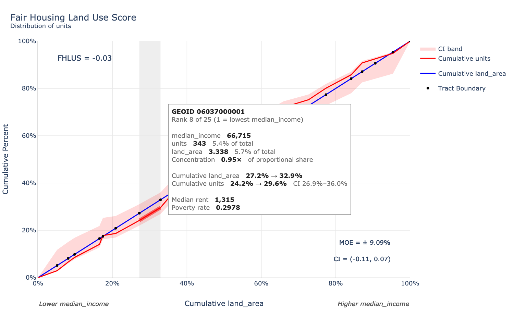
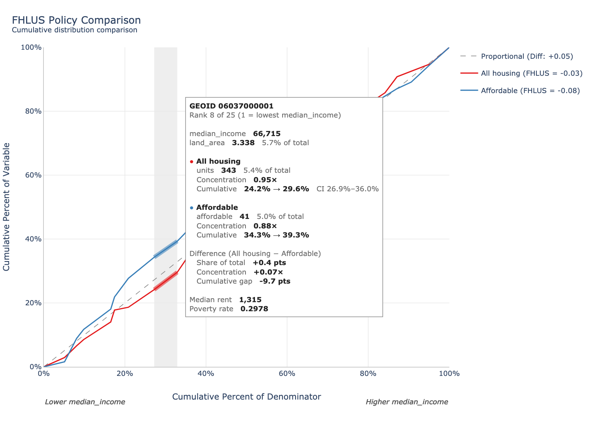

# fhlus: Fair Housing Land Use Score

## Overview

The **fhlus** package calculates the Fair Housing Land Use Score (FHLUS), a statistical measure that analyzes the spatial distribution of housing units (or other variables) across geographic areas ranked by opportunity indicators.

**FHLUS scores range from -1 to +1:**

- **+1.0**: All units concentrated in highest-opportunity areas (ideal)
- **0.0**: Proportional distribution matching area distribution (neutral)
- **-1.0**: All units concentrated in lowest-opportunity areas (concerning)

This tool helps urban planners, housing researchers, and policymakers assess whether affordable housing or other resources are equitably distributed across neighborhoods with varying levels of opportunity.

## Installation

Install the development version from GitHub:

```r
# install.packages("devtools")
devtools::install_github("aaronbarrall/fhlus")
```

## Quick Start

```r
library(fhlus)

# Create sample data
sample_data <- data.frame(
  tract_id = 1:10,
  housing_units = c(100, 150, 200, 120, 180, 90, 160, 140, 110, 130),
  median_income = c(45000, 62000, 38000, 71000, 55000,
                    82000, 48000, 66000, 59000, 74000),
  land_area = c(2.5, 3.1, 1.8, 2.9, 3.5, 2.2, 2.7, 3.3, 2.1, 2.8)
)

# Calculate FHLUS
result <- fhlus_score(
  df = sample_data,
  numerator = "housing_units",  # Variable of interest
  rank_var = "median_income",    # Opportunity indicator (higher = better)
  denom = "land_area"            # Denominator (typically area)
)

# View results
print(result)
result$scores
```

## Key Features

### Core Functionality

- **`fhlus_score()`**: Calculate FHLUS for a single dataset
- **`grouped_fhlus()`**: Calculate FHLUS for multiple groups (e.g., by city or county)
- **`fhlus_compare()`**: Compare two FHLUS results on a single plot (e.g., policy alternatives)
- **Confidence intervals**: Handle uncertainty with `missing` or `missing_pct` parameters
- **CI ribbon bands**: Visualize confidence interval envelopes with `show_ci_bands = TRUE`
- **Visualization**: Automatic generation of cumulative distribution curves

### Data Preparation

- **`validate_fhlus_data()`**: Check data quality before calculation
- **`prepare_spatial_fhlus()`**: Prepare spatial data with attribute-based or spatial layer exclusions (requires `sf` package)
- **`aggregate_to_neighborhoods()`**: Aggregate point data to geographic units
- **`spatial_impute()`**: Impute missing values using spatial neighbors

### Analysis & Comparison Tools

- **`fhlus_compare()`**: Side-by-side policy comparison with overlaid curves and CI bands
- **`analyze_grouped_fhlus()`**: Comparative analysis with correlations
- **`plot_grouped_fhlus()`**: Visualize grouped results
- **`calculate_multiple_indices()`**: Analyze multiple opportunity metrics
- **`export_fhlus()`**: Export to CSV, Excel, JSON, or RDS

### Interactive Plots

- **`fhlus_interactive()`**: Hover over each geography's segment of the curve to see its ID, rank, values, shares, concentration and any other variables
- **`fhlus_compare_interactive()`**: Interactive policy comparison, with one combined pop-up per geography
- **`fhlus_save_html()`**: Save an interactive plot as a standalone HTML file
- **`fhlus_segments()`**: Per-geography table behind the plots (for your own analysis or for joining to maps)

## Example: Grouped Analysis

```r
# Calculate FHLUS for multiple cities
regional_data <- data.frame(
  city = rep(c("City A", "City B", "City C"), each = 10),
  tract_id = 1:30,
  housing_units = sample(50:200, 30, replace = TRUE),
  median_income = sample(30000:90000, 30, replace = TRUE),
  land_area = runif(30, 1, 5)
)

grouped_results <- grouped_fhlus(
  df = regional_data,
  group_var = "city",
  numerator = "housing_units",
  rank_var = "median_income",
  denom = "land_area"
)

# View results — one row per group with score, score_lowest, score_highest
print(grouped_results)

# Per-group error rates (each city can have a different margin of error)
# regional_data$pct_error <- c(rep(0.05, 10), rep(0.10, 10), rep(0.15, 10))
# grouped_results <- grouped_fhlus(..., missing_pct = "pct_error")

# Visualize
plot_grouped_fhlus(grouped_results, score_col = "score", n_groups = 3)
```

## Example: Confidence Intervals

```r
# With 10% margin of error
result <- fhlus_score(
  df = sample_data,
  numerator = "housing_units",
  rank_var = "median_income",
  denom = "land_area",
  missing_pct = 0.10
)

# View confidence interval
result$confidence_interval
result$scores  # Shows base, lowest, highest scores

# With CI ribbon band on the plot
result <- fhlus_score(
  df = sample_data,
  numerator = "housing_units",
  rank_var = "median_income",
  denom = "land_area",
  missing_pct = 0.10,
  show_ci_bands = TRUE  # Shaded envelope between CI curves
)
```

## Example: Policy Comparison

```r
# Compare two variables (e.g., all housing vs. affordable housing)
result_all <- fhlus_score(sample_data, "housing_units", "median_income",
                          "land_area", missing_pct = 0.10, graph = FALSE)
result_aff <- fhlus_score(sample_data, "affordable_units", "median_income",
                          "land_area", missing_pct = 0.10, graph = FALSE)

# Overlay both curves on one plot
comparison <- fhlus_compare(
  result_all, result_aff,
  label_a = "All Housing",
  label_b = "Affordable Housing",
  show_ci = TRUE,       # CI ribbon bands (optional)
  rank_var = "median_income"
)

comparison$plot        # ggplot object
comparison$scores      # Score table with CI bounds
comparison$difference  # Numeric difference
```

## Interactive Plots

Interactive plots let you explore the FHLUS curve geography by geography. Hover
anywhere on the curve to see a pop-up for the tract (or block group,
neighborhood, ...) under the cursor. The tract's segment of the curve is
highlighted, and its share of the x-axis is shaded. The plots work in the
RStudio/Positron viewer, in R Markdown/Quarto documents and in Shiny apps. You
can also save them as a single HTML file that opens in any web browser, without R.

Requires two optional packages:

```r
install.packages(c("plotly", "htmlwidgets"))
```

For a full walkthrough, see `vignette("interactive-plots", package = "fhlus")`.

### How to read the curve

Geographies are sorted from lowest to highest opportunity (by `rank_var`).
**Each geography is one segment of the red curve**:

- its **width** is the geography's share of the denominator (e.g. its share of
  land area), and
- its **rise** is its share of the numerator (e.g. its share of housing units).

So the slope of a segment is the geography's **concentration**: its share of
units divided by its share of land.

- **1.00×** means proportional.
- **2.00×** means twice its proportional share.
- **0.50×** means half its proportional share.

Steep segments on the right-hand side (high opportunity) push the score up.
Steep segments on the left push it down.

### Single result

```r
library(fhlus)

tracts <- data.frame(
  GEOID         = sprintf("06037%06d", 1:10),
  housing_units = c(100, 150, 200, 120, 180, 90, 160, 140, 110, 130),
  median_income = c(45000, 62000, 38000, 71000, 55000,
                    82000, 48000, 66000, 59000, 74000),
  land_area     = c(2.5, 3.1, 1.8, 2.9, 3.5, 2.2, 2.7, 3.3, 2.1, 2.8),
  median_rent   = c(1400, 1750, 1200, 2100, 1600, 2500, 1350, 1900, 1700, 2200),
  pct_poverty   = c(0.22, 0.12, 0.31, 0.08, 0.15, 0.05, 0.25, 0.10, 0.14, 0.07)
)

result <- fhlus_score(tracts, numerator = "housing_units",
                      rank_var = "median_income", denom = "land_area",
                      missing_pct = 0.10, graph = FALSE)

fhlus_interactive(
  result,
  id = "GEOID",                                   # optional: GEOID is found automatically
  tooltip_vars = c("Median rent"  = "median_rent", # any other columns, with display labels
                   "Poverty rate" = "pct_poverty"),
  show_ci_bands = TRUE
)
```



*(Static illustration of a hovered tract. In the live plot, the pop-up follows
the cursor.)*

The pop-up has four sections:

| Section | Contents |
|---|---|
| Header | Geography ID, and its rank (1 = lowest opportunity) |
| Values | Rank variable(s); numerator and denominator with each one's share of the total; excluded area (if `exclude_area` was used); concentration |
| Cumulative | Where the segment starts and ends on each axis; the CI range (if `missing`/`missing_pct` was used) |
| Extra variables | Each column in `tooltip_vars` |

`tooltip_vars` can be **any column of the data passed to `fhlus_score()`**,
including variables that weren't used for ranking. That lets you see, for
example, rents or demographics alongside the FHLUS curve. Name the elements to
give them readable labels; unnamed elements use the column name.

### Policy comparison

`fhlus_compare_interactive()` is the interactive counterpart to `fhlus_compare()`.
Hovering shows **one combined pop-up** per geography:

```r
tracts$affordable_units <- c(30, 20, 60, 10, 25, 5, 40, 15, 20, 10)

result_all <- fhlus_score(tracts, "housing_units", "median_income", "land_area",
                          missing_pct = 0.10, graph = FALSE)
result_aff <- fhlus_score(tracts, "affordable_units", "median_income", "land_area",
                          graph = FALSE)

fhlus_compare_interactive(
  result_all, result_aff,
  label_a = "All housing", label_b = "Affordable",
  tooltip_vars = c("Median rent" = "median_rent", "Poverty rate" = "pct_poverty")
)
```



- **Shown once:** ID, rank, rank variable, denominator and extra variables.
- **One block per policy:** its value and share of the total, concentration,
  and cumulative share (with the CI if that result has one).
- **Difference (A − B):**
  - *Share of total*: the difference in percentage points.
  - *Concentration*: the difference in concentration.
  - *Cumulative gap*: the vertical distance between the two curves at the end
    of the segment.
- **Highlighting:** the geography is highlighted on both curves.
- **Mismatched results:** if the two results don't share the same geographies
  or denominator, each curve gets its own hover target, and the pop-up is for
  whichever curve is nearest the cursor. A geography missing from one result is
  marked *Not in this result*.

### Saving as HTML

```r
w <- fhlus_interactive(result, tooltip_vars = c("Median rent" = "median_rent"))
fhlus_save_html(w, "fhlus_tracts.html")

# Or straight from a result (extra arguments go to fhlus_interactive())
fhlus_save_html(result, "fhlus_tracts.html", tooltip_vars = "median_rent")
```

The file is fully self-contained (about 4 MB, mostly the plotly library). You
can email it, post it or open it offline. Making a single-file export needs
pandoc, which comes with RStudio, Positron and Quarto. If pandoc isn't found,
`fhlus_save_html()` warns you and writes the supporting files to a
`<name>_files/` folder next to the HTML instead. Keep that folder with the file.

### Options

| Argument | Function | Purpose |
|---|---|---|
| `id` | both | Geography ID column. Default: `GEOID`/`geoid`/`GEOID20`/`GEOID10` if present, otherwise the rank position |
| `tooltip_vars` | both | Extra columns for the pop-up; names become labels |
| `show_ci_bands` / `show_ci` | single / compare | Draw the CI ribbon (needs `missing` or `missing_pct`) |
| `highlight` | both | Highlight the hovered segment (default `TRUE`) |
| `title`, `subtitle` | both | Plot titles |
| `color_var`, `color_denom` | single | Line colors (default red/blue, as in the static plot) |
| `color_a`, `color_b` | compare | Curve colors |
| `boundary_label` | single | Legend label for the boundary points; `NULL` hides them |
| `annotation`, `annotation_x`, `annotation_y` | single | Score label, same as `fhlus_score()` |
| `width`, `height` | both | Size in pixels (default: fill the container) |
| `source` | both | plotly event source ID, used in Shiny |

Above 2,000 geographies, the plot automatically switches to WebGL rendering to
stay responsive.

### The data behind the plot

`fhlus_segments()` returns the table the plots are built from, with one row per
geography:

```r
fhlus_segments(result, tooltip_vars = "median_rent")
#> FHLUS segments: 10 geographies, housing_units ranked by median_income
#> # A tibble: 10 × 15
#>    id           rank cum_denom_start cum_denom_end cum_var_start cum_var_end
#>    <chr>       <dbl>           <dbl>         <dbl>         <dbl>       <dbl>
#>  1 06037000003     1          0             0.0669         0           0.145
#>  2 06037000001     2          0.0669        0.160          0.145       0.217
#>  3 06037000007     3          0.160         0.260          0.217       0.333
#> ...
#> # ℹ 9 more variables: share_denom <dbl>, share_var <dbl>, concentration <dbl>,
#> #   cum_var_lowest <dbl>, cum_var_highest <dbl>, median_income <dbl>,
#> #   housing_units <dbl>, land_area <dbl>, median_rent <dbl>
```

| Column | Meaning |
|---|---|
| `id`, `rank` | Geography ID and rank (1 = lowest opportunity) |
| `cum_denom_start`, `cum_denom_end` | Where the segment starts/ends on the x-axis |
| `cum_var_start`, `cum_var_end` | Where the segment starts/ends on the y-axis |
| `share_denom`, `share_var` | The geography's own share of the denominator/numerator |
| `concentration` | `share_var / share_denom` (the segment's slope); `NA` if the denominator is 0 |
| `cum_var_lowest`, `cum_var_highest` | Cumulative numerator share under the two CI scenarios (only with `missing`/`missing_pct`) |
| *(raw columns)* | Rank variable(s), numerator, denominator, excluded area, tie breakers, `tooltip_vars` |

Use it for your own tables or charts, or to join FHLUS results to a map
(`dplyr::left_join(tracts_sf, segs, by = c("GEOID" = "id"))`).

### In Shiny

The plots are ordinary plotly widgets. Each hover point carries the geography ID
in `customdata`, so a Shiny app can react to what's being hovered:

```r
output$curve <- plotly::renderPlotly(
  fhlus_interactive(result(), tooltip_vars = "median_rent", source = "fhlus")
)

hovered_geoid <- reactive({
  ev <- plotly::event_data("plotly_hover", source = "fhlus")
  if (is.null(ev)) NULL else ev$customdata
})
```

## Example: Multiple Opportunity Indices

```r
# Analyze multiple opportunity measures
sample_data$poverty_rate <- runif(10, 0.05, 0.30)

indices <- list(
  income = list(
    numerator = "housing_units",
    rank_var = "median_income",
    denom = "land_area"
  ),
  poverty = list(
    numerator = "housing_units",
    rank_var = "poverty_rate",
    denom = "land_area",
    ascending = FALSE  # Lower poverty is better
  )
)

results <- calculate_multiple_indices(sample_data, indices)
print(results$wide)
```

## Interpretation Guide

### Understanding FHLUS Scores

- **Positive scores (0 to +1)**: Housing units are more concentrated in higher-opportunity areas
  - **0.5 to 1.0**: Strong concentration in high-opportunity areas
  - **0.0 to 0.5**: Moderate concentration in high-opportunity areas

- **Negative scores (-1 to 0)**: Housing units are more concentrated in lower-opportunity areas
  - **-0.5 to 0.0**: Moderate concentration in low-opportunity areas
  - **-1.0 to -0.5**: Strong concentration in low-opportunity areas

- **Near-zero scores**: Distribution roughly proportional to available land area

## Data Requirements

Your data must include:

1. **Numerator**: The variable of interest (e.g., housing units, affordable units)
2. **Rank variable**: Opportunity indicator(s) where higher values = better opportunity
   - For "lower is better" metrics (e.g., poverty rate), use negative values or the `ascending = FALSE` parameter
3. **Denominator**: Typically land area in the same units across observations. Other common options are neighborhood population or housing units

Minimum requirements:
- At least 2 observations
- Numeric columns for numerator, rank_var, and denominator
- No all-NA columns

## Spatial Data Support

```r
library(sf)

# Read spatial data
tracts_sf <- st_read("tracts.shp")

# Attribute-based exclusion (marks entire features)
tracts_prepared <- prepare_spatial_fhlus(
  spatial_data = tracts_sf,
  area_crs = 3857,              # Projected CRS for area calculation
  exclude_zones = "Open space", # Optional: exclude certain areas
  zone_column = "land_use"
)

# Spatial layer exclusion (true geometric intersection)
parks_sf <- st_read("parks.shp")
tracts_prepared <- prepare_spatial_fhlus(
  spatial_data = tracts_sf,
  area_crs = 3857,
  exclude_layer = parks_sf  # Dissolves & intersects with source features
)

# Both approaches can be combined (exclusions are additive)
tracts_prepared <- prepare_spatial_fhlus(
  spatial_data = tracts_sf,
  area_crs = 3857,
  exclude_zones = "Open space",
  zone_column = "land_use",
  exclude_layer = parks_sf
)

# Calculate FHLUS
result <- fhlus_score(
  df = tracts_prepared,
  numerator = "housing_units",
  rank_var = "median_income",
  denom = "available_area"  # Created by prepare_spatial_fhlus
)
```

## Export Results

```r
# Export to CSV
export_fhlus(result, filename = "my_fhlus_results", format = "csv")

# Export to Excel with plot
export_fhlus(result, filename = "my_fhlus_results",
             format = "xlsx", include_plot = TRUE)

# Export full R object
export_fhlus(result, filename = "my_fhlus_results", format = "rds")
```

## Getting Help

- **Documentation**: See `?fhlus_score`, `?grouped_fhlus`, or `?fhlus_compare` for detailed help
- **Vignettes**:
  - `vignette("fhlus-intro")`: Introduction and basic usage
  - `vignette("fhlus-advanced")`: Advanced features and spatial data
- **Issues**: Report bugs at <https://github.com/aaronbarrall/fhlus/issues>

## Citation

If you use this package in publications, please cite:

```r
citation("fhlus")
```

## License

MIT License - see LICENSE file for details
