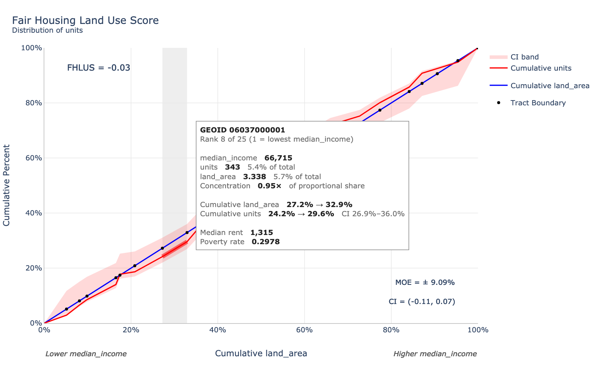
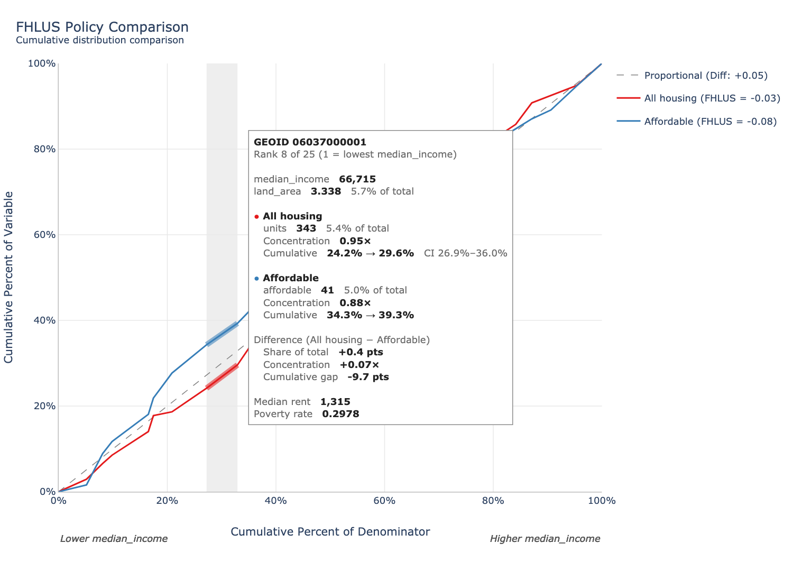
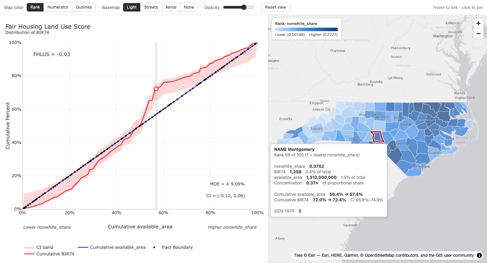

# fhlus: Fair Housing Land Use Score

## Overview

The **fhlus** package calculates the Fair Housing Land Use Score (FHLUS), a statistical measure that analyzes the spatial distribution of housing units (or other variables) across geographic areas ranked by opportunity indicators.

**FHLUS scores range from -1 to +1:**

- **+1.0**: All units concentrated in highest-opportunity areas (ideal)
- **0.0**: Proportional distribution matching area distribution (neutral)
- **-1.0**: All units concentrated in lowest-opportunity areas (concerning)

This tool helps urban planners, housing researchers, and policymakers assess whether affordable housing or other resources are equitably distributed across neighborhoods with varying levels of opportunity.

## Installation

Install the development version from GitHub:

```r
# install.packages("devtools")
devtools::install_github("aaronbarrall/fhlus")
```

## Quick Start

```r
library(fhlus)

# Create sample data
sample_data <- data.frame(
  tract_id = 1:10,
  housing_units = c(100, 150, 200, 120, 180, 90, 160, 140, 110, 130),
  median_income = c(45000, 62000, 38000, 71000, 55000,
                    82000, 48000, 66000, 59000, 74000),
  land_area = c(2.5, 3.1, 1.8, 2.9, 3.5, 2.2, 2.7, 3.3, 2.1, 2.8)
)

# Calculate FHLUS
result <- fhlus_score(
  df = sample_data,
  numerator = "housing_units",  # Variable of interest
  rank_var = "median_income",    # Opportunity indicator (higher = better)
  denom = "land_area"            # Denominator (typically area)
)

# View results
print(result)
result$scores
```

## Function Reference

Every function the package exports, grouped by task. The tables below list only the key arguments; see [Argument Reference](#argument-reference) for every argument of every function, or run `?function_name`.

### Calculating scores

| Function | What it does | Key arguments |
|---|---|---|
| `fhlus_score()` | Calculates FHLUS for one dataset and returns the score, AUC, cumulative curve data, plot and metadata. Rows with a missing rank value are dropped, imputed from their neighbors, or refused (see [Missing rank values](#missing-rank-values)). | `df`, `numerator`, `rank_var`, `denom`, `missing` / `missing_pct` (confidence interval), `tie_breaker`, `exclude_area`, `rank_na`, `show_ci_bands`, `graph`, `verbose` |
| `grouped_fhlus()` | Calculates FHLUS for every group (e.g., each city), one row per group with `score`, `score_lowest`, `score_highest` (plus `n_rank_imputed` / `n_rank_dropped`). Per-group error rates can come from a column. | `df`, `group_var`, the `fhlus_score()` arguments, `graph_subset`, `parallel` (needs `furrr`) |
| `calculate_multiple_indices()` | Runs FHLUS for several opportunity measures (e.g., income and poverty) at once, optionally by group. Returns long and wide tables. | `data`, `indices` (named list of specs, each can set `ascending = FALSE`), `group_var` |

### Preparing spatial data (requires `sf`)

| Function | What it does | Key arguments |
|---|---|---|
| `prepare_spatial_fhlus()` | One call for the whole spatial pipeline: reproject, clip neighborhoods to a jurisdiction, calculate `total_area` / `excluded_area` / `available_area`, and sum a spatial numerator into the neighborhoods. Prints numbered progress steps and warns when a job looks slow. | `spatial_data`, `area_crs`, `boundary`, `boundary_id`, `min_share`, `numerator`, `numerator_vars`, `numerator_method`, `exclude_zones` / `zone_column`, `exclude_layer`, `outside`, `verbose` |
| `clip_to_boundary()` | Clips neighborhoods (e.g., tracts) to a boundary so only area inside the jurisdiction counts in the denominator. Adds `original_area` and `share_in_boundary`, and drops slivers. With `boundary_id`, clips to several jurisdictions at once and stacks the result. | `neighborhoods`, `boundary`, `boundary_id`, `min_share` |
| `assign_to_neighborhoods()` | Sums a numerator layer (points or polygons) into neighborhoods. Every neighborhood is kept, with 0 where nothing falls. A point on a shared edge is counted once. It reports how much was assigned and what fell outside. | `numerator`, `neighborhoods`, `vars`, `method` (`"point_on_surface"` or `"area_weighted"`), `count_col`, `outside` |
| `aggregate_to_neighborhoods()` | Older interface to `assign_to_neighborhoods()`, kept for existing scripts. Adds `total_units` and `n_sites`. | `units_data`, `neighborhoods`, `unit_var`, `neighborhood_id` |
| `spatial_impute()` | Fills missing values from neighboring features (needs `spdep`). | `spatial_data`, `impute_var`, `method` (`"mean"`, `"median"`, `"idw"`), `k` |
| `validate_fhlus_data()` | Checks a data frame before scoring: missing columns, NAs, negative values, too few rows. | `data`, `numerator`, `rank_var`, `denom` |

### Comparing and analyzing results

| Function | What it does | Key arguments |
|---|---|---|
| `fhlus_compare()` | Overlays two results on one plot (e.g., all housing vs. affordable housing) with labeled scores, their difference, and optional CI ribbons. | `result_a`, `result_b`, `label_a`, `label_b`, `show_ci`, `rank_var` |
| `analyze_grouped_fhlus()` | Joins grouped scores to group characteristics (e.g., city size) and reports correlations. | `grouped_results`, `group_characteristics`, `join_by` |
| `plot_grouped_fhlus()` | Bar chart of grouped scores. | `grouped_results`, `score_col`, `n_groups`, `highlight_groups` |

### Interactive plots (require `plotly` and `htmlwidgets`)

| Function | What it does | Key arguments |
|---|---|---|
| `fhlus_interactive()` | Interactive version of the FHLUS plot. Hovering shows each geography's ID, rank, values, shares, concentration and any extra variables. | `result`, `id`, `tooltip_vars`, `show_ci_bands` |
| `fhlus_compare_interactive()` | Interactive version of `fhlus_compare()`, with one combined pop-up per geography. | `result_a`, `result_b`, `label_a`, `label_b`, `id`, `tooltip_vars`, `show_ci` |
| `fhlus_save_html()` | Saves an interactive plot, a linked map (or a result directly) as a standalone HTML file. | `x`, `file`, `selfcontained` |
| `fhlus_segments()` | The per-geography table behind the interactive plots, for your own analysis or joining to maps. | `result`, `id`, `tooltip_vars` |

### Linked plot and map (require `plotly`, `htmlwidgets`, `sf` and `jsonlite`)

| Function | What it does | Key arguments |
|---|---|---|
| `fhlus_linked()` | The interactive plot next to a map of the same geographies, linked both ways: hover a segment to outline its neighborhood, hover a neighborhood to highlight its segment, click to pin. Map colors (rank, numerator, outlines) and basemaps (light, streets, aerial) switch in the page. Can also draw the site-level numerator (points or polygons) and neighborhoods left unscored for a missing rank value. | `result`, `geometry`, `id`, `tooltip_vars`, `numerator_layer`, `numerator_var`, `fill_by`, `basemap` |
| `fhlus_linkedOutput()` / `renderFhlus_linked()` | Shiny output and render functions for `fhlus_linked()` (also need `shiny`). The hovered and pinned IDs arrive as `input$<id>_hover` and `input$<id>_selected`. | `outputId` |

### Exporting

| Function | What it does | Key arguments |
|---|---|---|
| `export_fhlus()` | Writes a result, grouped result or data frame to CSV, Excel (with plot; needs `openxlsx`), JSON (needs `jsonlite`) or RDS. | `results`, `filename`, `format`, `include_plot` |
| `fhlus_to_list()` | Converts a result to plain lists and data frames ready for `jsonlite::toJSON()` (used by the web app). Currently `format_version` 2. | `result`, `id`, `tooltip_vars` |

### Print methods

`print()` has methods for `fhlus` (score summary and plot), `grouped_fhlus` (summary statistics and top/bottom groups), `fhlus_compare` (both scores and the plot) and `fhlus_segments` (one-line summary and the table).

## Argument Reference

Every argument of every exported function. "required" means there is no default. Where an argument takes one of several fixed values, the first value listed is the default.

### `fhlus_score()`

| Argument | Default | Description |
|---|---|---|
| `df` | required | Data frame with one row per geography. |
| `numerator` | required | Column with the variable being distributed (e.g., housing units). |
| `rank_var` | required | Column (or vector of columns, applied in order) used to rank geographies. Higher values = higher opportunity. |
| `denom` | required | Column with the denominator, usually land area (e.g., `available_area`). Rows with a zero denominator are dropped. |
| `missing` | `NULL` | Margin of error in absolute numerator units. Adds lowest/highest scores by giving those units to the lowest- or highest-ranked areas. |
| `missing_pct` | `NULL` | Margin of error as a share of the numerator total (0-1). Overrides `missing` if both are given. |
| `graph` | `TRUE` | Draw the cumulative distribution plot. |
| `exclude_area` | `NULL` | Column with area to subtract from the denominator (e.g., `excluded_area` from `prepare_spatial_fhlus()`). The score uses `denom - exclude_area` (floored at 0), stored in `result$data` as `<denom>_adjusted`; the `denom` column keeps its original values. |
| `tie_breaker` | `NULL` | Column(s) used to order geographies with tied `rank_var` values. |
| `rank_na` | `"auto"` | Rows with a missing rank value: `"auto"` drops those with no numerator and imputes those with numerator values (error if they can't be imputed), `"impute"` imputes all, `"drop"` drops all (warning about any numerator lost). See [Missing rank values](#missing-rank-values). |
| `impute_method` | `"mean"` | Imputation method passed to `spatial_impute()`: `"mean"`, `"median"` or `"idw"`. |
| `impute_k` | `5` | Number of nearest neighbors used for imputation. |
| `boundary_label` | `"Tract Boundary"` | Legend label for the boundary points on the plot; `NULL` hides them. |
| `plot_subtitle` | `NULL` | Custom plot subtitle (`grouped_fhlus()` uses it for the group name). |
| `show_ci_bands` | `FALSE` | Draw the confidence interval as a ribbon (needs `missing` or `missing_pct`). |
| `ci_alpha` | `0.15` | Ribbon transparency (0-1). |
| `annotation` | `TRUE` | Score label on the plot: `TRUE` shows "FHLUS = X", `FALSE`/`NULL` hides it, a string is shown as-is. |
| `annotation_x` | `0.125` | Horizontal position of the score label (0-1). |
| `annotation_y` | `0.93` | Vertical position of the score label (0-1). |
| `verbose` | `TRUE` | Print warnings and messages (e.g., about dropped rows). |

### `grouped_fhlus()`

| Argument | Default | Description |
|---|---|---|
| `df` | required | Data frame with all groups stacked (one row per geography per group). |
| `group_var` | required | Column naming each group (e.g., `"city_name"`, or the `boundary_id` from `prepare_spatial_fhlus()`). |
| `numerator` | required | As in `fhlus_score()`. |
| `rank_var` | required | As in `fhlus_score()`. |
| `denom` | required | As in `fhlus_score()`. |
| `missing` | `NULL` | A number applied to every group, or the name of a column holding each group's margin of error in units. |
| `missing_pct` | `NULL` | A share (0-1) applied to every group, or the name of a column holding each group's margin of error as a share. |
| `exclude_area` | `NULL` | As in `fhlus_score()`. |
| `tie_breaker` | `NULL` | As in `fhlus_score()`. |
| `rank_na`, `impute_method`, `impute_k` | `"auto"`, `"mean"`, `5` | As in `fhlus_score()`, applied within each group (imputation uses neighbors in the same group). A group that can't be scored gets an NA score with the reason in `error_reason`. |
| `graph` | `FALSE` | Draw a plot per group. Plots are also stored in `attr(result, "plots")`. |
| `graph_subset` | `NULL` | Group values to plot; `NULL` plots all (when `graph = TRUE`). |
| `verbose` | `TRUE` | Print progress messages. |
| `parallel` | `FALSE` | Process groups in parallel (needs `furrr`; worthwhile for about 20+ groups). |

### `calculate_multiple_indices()`

| Argument | Default | Description |
|---|---|---|
| `data` | required | Data frame with all the variables. |
| `indices` | required | Named list, one element per index. Each element is a list with `numerator`, `rank_var`, `denom`, and optionally `missing`, `missing_pct`, `exclude_area`, `tie_breaker`, and `ascending` (`FALSE` when lower values mean higher opportunity, e.g., poverty rate). |
| `group_var` | `NULL` | Optional group column; if given, each index is run with `grouped_fhlus()`. |

### `prepare_spatial_fhlus()`

| Argument | Default | Description |
|---|---|---|
| `spatial_data` | required | sf polygons (e.g., tracts) with their attributes (rank variables etc.). |
| `area_crs` | `NULL` | Projected CRS to transform to before measuring area (e.g., a State Plane or UTM EPSG code). `NULL` keeps the current CRS and warns if it is lat/lon. |
| `exclude_zones` | `NULL` | Values of `zone_column` whose whole features are excluded from the area (e.g., `"Open space"`). |
| `zone_column` | `NULL` | Column holding the zone values for `exclude_zones`. |
| `exclude_layer` | `NULL` | sf polygons to subtract from the area (e.g., parks). Dissolved and intersected with each feature; adds to any zone exclusion. |
| `boundary` | `NULL` | sf polygons to clip the neighborhoods to (e.g., a city). Without `boundary_id`, all features are merged into one area. |
| `boundary_id` | `NULL` | Column in `boundary` naming each jurisdiction. Clips each separately and stacks the result with this column added; use it as `group_var` in `grouped_fhlus()`. |
| `min_share` | `0.01` | Clipped pieces smaller than this share of their original neighborhood are dropped as slivers. `0` keeps all. |
| `numerator` | `NULL` | sf points or polygons (e.g., housing sites) to sum into the neighborhoods. |
| `numerator_vars` | `NULL` | Columns of `numerator` to sum. Named vector renames them (e.g., `c(units = "net_units")`). `NULL` adds only the feature count. |
| `numerator_method` | `"point_on_surface"` | How polygon numerators are assigned: `"point_on_surface"` (each polygon goes to one neighborhood) or `"area_weighted"` (split by overlap area). |
| `count_col` | `"n_features"` | Name of the output column counting numerator features per neighborhood. |
| `outside` | `"warn"` | What to do when numerator features inside the boundary fall outside every neighborhood: `"warn"`, `"error"` or `"ignore"`. |
| `verbose` | `TRUE` | Print numbered progress messages. |

### `clip_to_boundary()`

| Argument | Default | Description |
|---|---|---|
| `neighborhoods` | required | sf polygons (e.g., tracts). |
| `boundary` | required | sf polygons to clip to. Without `boundary_id`, merged into one area. |
| `boundary_id` | `NULL` | Column in `boundary` naming each jurisdiction; clips each separately and stacks the pieces with this column added. |
| `min_share` | `0.01` | Pieces smaller than this share of their original neighborhood are dropped. `0` keeps all. |
| `verbose` | `TRUE` | Print a summary of what was clipped. |

### `assign_to_neighborhoods()`

| Argument | Default | Description |
|---|---|---|
| `numerator` | required | sf points or polygons to sum. |
| `neighborhoods` | required | sf polygons to sum into (all rows are kept, in order, with 0 where nothing falls). |
| `vars` | `NULL` | Numeric columns of `numerator` to sum. Named vector renames them. `NULL` adds only the count. NAs count as 0 (with a warning). |
| `method` | `"point_on_surface"` | For polygon numerators: `"point_on_surface"` or `"area_weighted"`. Ignored for points. |
| `count_col` | `"n_features"` | Name of the output count column; `NULL` skips it. |
| `outside` | `"warn"` | What to do when features fall outside every neighborhood: `"warn"`, `"error"` or `"ignore"`. They are dropped either way. |
| `verbose` | `TRUE` | Print an assignment summary. |

### `aggregate_to_neighborhoods()`

Older wrapper around `assign_to_neighborhoods()`.

| Argument | Default | Description |
|---|---|---|
| `units_data` | required | sf points or polygons with unit counts (e.g., buildings). |
| `neighborhoods` | required | sf neighborhood polygons. |
| `unit_var` | required | Column of `units_data` to sum; output column is `total_units` (count column is `n_sites`). |
| `neighborhood_id` | required | ID column in `neighborhoods`. Only checked to exist; the output keeps the neighborhoods' rows and order. |
| `method` | `"point_on_surface"` | As in `assign_to_neighborhoods()`. |

### `spatial_impute()`

| Argument | Default | Description |
|---|---|---|
| `spatial_data` | required | sf object with the variable to fill (needs `spdep`). |
| `impute_var` | required | Column with missing values to fill. |
| `method` | `"mean"` | `"mean"`, `"median"` or `"idw"` (inverse distance weighted) of the neighbors' values. |
| `k` | `5` | Number of nearest neighbors used. |

### `validate_fhlus_data()`

| Argument | Default | Description |
|---|---|---|
| `data` | required | Data frame to check. |
| `numerator` | required | Numerator column. |
| `rank_var` | required | Ranking column(s). |
| `denom` | required | Denominator column. |
| `verbose` | `TRUE` | Print detailed messages. |

### `fhlus_compare()`

| Argument | Default | Description |
|---|---|---|
| `result_a`, `result_b` | required | Two `fhlus_score()` results. |
| `label_a` | `"Policy A"` | Label for the first result. |
| `label_b` | `"Policy B"` | Label for the second result. |
| `title` | `"FHLUS Policy Comparison"` | Plot title. |
| `subtitle` | `NULL` | Plot subtitle; `NULL` generates one. |
| `color_a` | `"#E41A1C"` | Color of the first curve. |
| `color_b` | `"#377EB8"` | Color of the second curve. |
| `show_reference` | `TRUE` | Draw the dashed proportional (diagonal) line. |
| `show_ci` | `FALSE` | Draw CI ribbons (results need `missing`/`missing_pct`; otherwise skipped with a warning). |
| `ci_alpha` | `0.15` | Ribbon transparency (0-1). |
| `rank_var` | `NULL` | Name shown in the "Lower/Higher ..." axis labels; `NULL` omits them. |

### `analyze_grouped_fhlus()`

| Argument | Default | Description |
|---|---|---|
| `grouped_results` | required | Output of `grouped_fhlus()`. |
| `group_characteristics` | `NULL` | Data frame of group attributes (e.g., population) to correlate with scores. |
| `join_by` | `NULL` | Column used to join `group_characteristics` to the results. |

### `plot_grouped_fhlus()`

| Argument | Default | Description |
|---|---|---|
| `grouped_results` | required | Output of `grouped_fhlus()`. |
| `score_col` | `"score"` | Column to plot: `"score"`, `"score_lowest"` or `"score_highest"`. |
| `n_groups` | `10` | Number of top and bottom groups to highlight. |
| `highlight_groups` | `NULL` | Specific group names to highlight (overrides `n_groups`). |

### `fhlus_interactive()`

| Argument | Default | Description |
|---|---|---|
| `result` | required | A `fhlus_score()` result. |
| `id` | `NULL` | Geography ID column. `NULL` looks for `GEOID`, `geoid`, `GEOID20`, `GEOID10`, then falls back to rank. |
| `tooltip_vars` | `NULL` | Extra columns to show on hover (any column in the data). Name them to set labels, e.g., `c("Median rent" = "rent")`. |
| `title` | `"Fair Housing Land Use Score"` | Plot title. |
| `subtitle` | `NULL` | Plot subtitle; `NULL` uses "Distribution of <numerator>". |
| `show_ci_bands` | `FALSE` | Draw the CI ribbon (needs `missing`/`missing_pct`). |
| `ci_alpha` | `0.15` | Ribbon transparency (0-1). |
| `color_var` | `"red"` | Color of the cumulative numerator line. |
| `color_denom` | `"blue"` | Color of the cumulative denominator line. |
| `boundary_label` | `"Tract Boundary"` | Legend label for boundary points; `NULL` hides them. |
| `annotation` | `TRUE` | Score label: `TRUE`, `FALSE`/`NULL`, or custom text. |
| `annotation_x` | `0.125` | Horizontal position of the score label (0-1). |
| `annotation_y` | `0.93` | Vertical position of the score label (0-1). |
| `highlight` | `TRUE` | Highlight the hovered geography's segment. |
| `width`, `height` | `NULL` | Widget size in pixels; `NULL` fills the container. |
| `source` | `"fhlus"` | Plotly event source ID, for reading hover events in Shiny with `plotly::event_data(source = ...)`. |
| `numerator`, `denom`, `rank_var` | `NULL` | Column names; only needed for results made before fhlus 0.3.0 (newer results store them in `result$meta`). |

### `fhlus_compare_interactive()`

| Argument | Default | Description |
|---|---|---|
| `result_a`, `result_b` | required | Two `fhlus_score()` results. |
| `label_a` | `"Policy A"` | Label for the first result. |
| `label_b` | `"Policy B"` | Label for the second result. |
| `id` | `NULL` | Geography ID column, as in `fhlus_interactive()`. Used to match geographies across the two results. |
| `tooltip_vars` | `NULL` | Extra hover columns, as in `fhlus_interactive()`. |
| `title` | `"FHLUS Policy Comparison"` | Plot title. |
| `subtitle` | `NULL` | Plot subtitle; `NULL` uses "Cumulative distribution comparison". |
| `color_a` | `"#E41A1C"` | Color of the first curve. |
| `color_b` | `"#377EB8"` | Color of the second curve. |
| `show_reference` | `TRUE` | Draw the dashed proportional line. |
| `show_ci` | `FALSE` | Draw CI ribbons for results that have them. |
| `ci_alpha` | `0.15` | Ribbon transparency (0-1). |
| `rank_var` | `NULL` | Name for the "Lower/Higher ..." labels; `NULL` uses `result_a`'s rank variable, `FALSE` hides them. |
| `highlight` | `TRUE` | Highlight the hovered segment. |
| `width`, `height` | `NULL` | Widget size in pixels; `NULL` fills the container. |
| `source` | `"fhlus"` | Plotly event source ID for Shiny. |

### `fhlus_linked()`

| Argument | Default | Description |
|---|---|---|
| `result` | required | Result from `fhlus_score()`. If it was computed on sf data (e.g. from `prepare_spatial_fhlus()`), its geometry is used. |
| `geometry` | `NULL` | sf polygons with the ID column, for results computed on plain data frames. Matched by ID; unmatched geographies are reported. Neighborhoods that `fhlus_score()` dropped for a missing rank value are drawn in grey as "not scored" when they have a polygon here. |
| `id` | `NULL` | ID column; auto-detects `GEOID`/`geoid`/`GEOID20`/`GEOID10`. |
| `tooltip_vars` | `NULL` | Extra columns for the pop-ups (named = display labels). |
| `numerator_layer` | `NULL` | sf layer of the site-level numerator: only points or only polygons, any CRS. Points are drawn as circles, polygons as shapes, each linked to the geography containing it. Show/hide in the page. |
| `numerator_var` | `NULL` | Numeric column of `numerator_layer` that sizes the points and appears in the pop-ups. Defaults to the result's numerator column if the layer has it; otherwise features are only counted. |
| `numerator_tooltip_vars` | `NULL` | Extra columns of `numerator_layer` for the feature pop-ups (named = display labels). |
| `numerator_label` | `NULL` | Name of the features in the toolbar, legend and pop-ups; defaults to `numerator_var` or "Features". |
| `fill_by` | `"rank"` | Initial map coloring: `"rank"`, `"numerator"` or `"none"` (outlines). Switchable in the page. |
| `basemap` | `"light"` | Initial basemap: `"light"`, `"streets"`, `"aerial"` or `"none"`. Switchable in the page. Esri tiles, no API key. |
| `fill_opacity` | `0.7` | Initial polygon fill opacity (0-1); there is also a slider in the page. |
| `layout` | `"side"` | `"side"` (plot left, map right) or `"stacked"`. Narrow containers always stack. |
| `simplify` | `NULL` | Simplification tolerance in meters. `NULL` simplifies only inputs over 100,000 vertices; `FALSE` never simplifies. |
| `max_features` | `5000` | Stop with an error above this many geographies. |
| `max_numerator_features` | `50000` | Stop with an error above this many `numerator_layer` features. |
| `width`, `height` | `NULL` | Widget size; `NULL` fills the container. |
| `elementId` | `NULL` | Optional element ID. |
| `...` | | Passed to `fhlus_interactive()` for the plot panel (e.g. `title`, `show_ci_bands`, `color_var`). |

### `fhlus_save_html()`

| Argument | Default | Description |
|---|---|---|
| `x` | required | A widget from `fhlus_interactive()`/`fhlus_compare_interactive()`/`fhlus_linked()`, or a `fhlus_score()` result. |
| `file` | required | Path of the HTML file to write. |
| `selfcontained` | `TRUE` | Embed everything in one file (needs pandoc; falls back to a folder with a warning if missing). |
| `title` | `"Fair Housing Land Use Score"` | Browser tab title. |
| `libdir` | `NULL` | Folder for dependencies when not self-contained; `NULL` uses `<file>_files`. |
| `...` | | Passed to `fhlus_interactive()` when `x` is a result (e.g., `id`, `tooltip_vars`). |

### `fhlus_segments()`

| Argument | Default | Description |
|---|---|---|
| `result` | required | A `fhlus_score()` result. |
| `id` | `NULL` | Geography ID column, as in `fhlus_interactive()`. |
| `tooltip_vars` | `NULL` | Extra columns to carry along. |
| `numerator`, `denom`, `rank_var` | `NULL` | Only needed for results made before fhlus 0.3.0. |

### `fhlus_to_list()`

| Argument | Default | Description |
|---|---|---|
| `result` | required | A `fhlus_score()` result. |
| `id` | `NULL` | Geography ID column, as in `fhlus_interactive()`. |
| `tooltip_vars` | `NULL` | Extra columns to include in the segments. |
| `tooltips` | `TRUE` | Add a `tooltip` column with each segment's HTML hover text. |
| `numerator`, `denom`, `rank_var` | `NULL` | Only needed for results made before fhlus 0.3.0. |

### `export_fhlus()`

| Argument | Default | Description |
|---|---|---|
| `results` | required | A `fhlus_score()` result, `grouped_fhlus()` result, or data frame. |
| `filename` | required | Output path without extension. |
| `format` | `"csv"` | `"csv"`, `"xlsx"` (needs `openxlsx`), `"rds"` or `"json"` (needs `jsonlite`). |
| `include_plot` | `TRUE` | Also save the plot as a PNG, if the result has one. |

## Example: Grouped Analysis

```r
# Calculate FHLUS for multiple cities
regional_data <- data.frame(
  city = rep(c("City A", "City B", "City C"), each = 10),
  tract_id = 1:30,
  housing_units = sample(50:200, 30, replace = TRUE),
  median_income = sample(30000:90000, 30, replace = TRUE),
  land_area = runif(30, 1, 5)
)

grouped_results <- grouped_fhlus(
  df = regional_data,
  group_var = "city",
  numerator = "housing_units",
  rank_var = "median_income",
  denom = "land_area"
)

# View results — one row per group with score, score_lowest, score_highest
print(grouped_results)

# Per-group error rates (each city can have a different margin of error)
# regional_data$pct_error <- c(rep(0.05, 10), rep(0.10, 10), rep(0.15, 10))
# grouped_results <- grouped_fhlus(..., missing_pct = "pct_error")

# Visualize
plot_grouped_fhlus(grouped_results, score_col = "score", n_groups = 3)
```

## Example: Confidence Intervals

```r
# With 10% margin of error
result <- fhlus_score(
  df = sample_data,
  numerator = "housing_units",
  rank_var = "median_income",
  denom = "land_area",
  missing_pct = 0.10
)

# View confidence interval
result$confidence_interval
result$scores  # Shows base, lowest, highest scores

# With CI ribbon band on the plot
result <- fhlus_score(
  df = sample_data,
  numerator = "housing_units",
  rank_var = "median_income",
  denom = "land_area",
  missing_pct = 0.10,
  show_ci_bands = TRUE  # Shaded envelope between CI curves
)
```

## Example: Policy Comparison

```r
# Compare two variables (e.g., all housing vs. affordable housing)
result_all <- fhlus_score(sample_data, "housing_units", "median_income",
                          "land_area", missing_pct = 0.10, graph = FALSE)
result_aff <- fhlus_score(sample_data, "affordable_units", "median_income",
                          "land_area", missing_pct = 0.10, graph = FALSE)

# Overlay both curves on one plot
comparison <- fhlus_compare(
  result_all, result_aff,
  label_a = "All Housing",
  label_b = "Affordable Housing",
  show_ci = TRUE,       # CI ribbon bands (optional)
  rank_var = "median_income"
)

comparison$plot        # ggplot object
comparison$scores      # Score table with CI bounds
comparison$difference  # Numeric difference
```

## Interactive Plots

Interactive plots let you explore the FHLUS curve geography by geography. Hover
anywhere on the curve to see a pop-up for the tract (or block group,
neighborhood, ...) under the cursor. The tract's segment of the curve is
highlighted, and its share of the x-axis is shaded. The plots work in the
RStudio/Positron viewer, in R Markdown/Quarto documents and in Shiny apps. You
can also save them as a single HTML file that opens in any web browser, without R.

Requires two optional packages:

```r
install.packages(c("plotly", "htmlwidgets"))
```

For a full walkthrough, see `vignette("interactive-plots", package = "fhlus")`.

### How to read the curve

Geographies are sorted from lowest to highest opportunity (by `rank_var`).
**Each geography is one segment of the red curve**:

- its **width** is the geography's share of the denominator (e.g. its share of
  land area), and
- its **rise** is its share of the numerator (e.g. its share of housing units).

So the slope of a segment is the geography's **concentration**: its share of
units divided by its share of land.

- **1.00×** means proportional.
- **2.00×** means twice its proportional share.
- **0.50×** means half its proportional share.

Steep segments on the right-hand side (high opportunity) push the score up.
Steep segments on the left push it down.

### Single result

```r
library(fhlus)

tracts <- data.frame(
  GEOID         = sprintf("06037%06d", 1:10),
  housing_units = c(100, 150, 200, 120, 180, 90, 160, 140, 110, 130),
  median_income = c(45000, 62000, 38000, 71000, 55000,
                    82000, 48000, 66000, 59000, 74000),
  land_area     = c(2.5, 3.1, 1.8, 2.9, 3.5, 2.2, 2.7, 3.3, 2.1, 2.8),
  median_rent   = c(1400, 1750, 1200, 2100, 1600, 2500, 1350, 1900, 1700, 2200),
  pct_poverty   = c(0.22, 0.12, 0.31, 0.08, 0.15, 0.05, 0.25, 0.10, 0.14, 0.07)
)

result <- fhlus_score(tracts, numerator = "housing_units",
                      rank_var = "median_income", denom = "land_area",
                      missing_pct = 0.10, graph = FALSE)

fhlus_interactive(
  result,
  id = "GEOID",                                   # optional: GEOID is found automatically
  tooltip_vars = c("Median rent"  = "median_rent", # any other columns, with display labels
                   "Poverty rate" = "pct_poverty"),
  show_ci_bands = TRUE
)
```



*(Static illustration of a hovered tract. In the live plot, the pop-up follows
the cursor.)*

The pop-up has four sections:

| Section | Contents |
|---|---|
| Header | Geography ID, and its rank (1 = lowest opportunity) |
| Values | Rank variable(s), marked "imputed" when a missing value was filled; numerator and denominator with each one's share of the total; with `exclude_area`, the total, the excluded area (and its share of the total) and the available area the score uses; concentration |
| Cumulative | Where the segment starts and ends on each axis; the CI range (if `missing`/`missing_pct` was used) |
| Extra variables | Each column in `tooltip_vars` |

`tooltip_vars` can be **any column of the data passed to `fhlus_score()`**,
including variables that weren't used for ranking. That lets you see, for
example, rents or demographics alongside the FHLUS curve. Name the elements to
give them readable labels; unnamed elements use the column name.

### Policy comparison

`fhlus_compare_interactive()` is the interactive counterpart to `fhlus_compare()`.
Hovering shows **one combined pop-up** per geography:

```r
tracts$affordable_units <- c(30, 20, 60, 10, 25, 5, 40, 15, 20, 10)

result_all <- fhlus_score(tracts, "housing_units", "median_income", "land_area",
                          missing_pct = 0.10, graph = FALSE)
result_aff <- fhlus_score(tracts, "affordable_units", "median_income", "land_area",
                          graph = FALSE)

fhlus_compare_interactive(
  result_all, result_aff,
  label_a = "All housing", label_b = "Affordable",
  tooltip_vars = c("Median rent" = "median_rent", "Poverty rate" = "pct_poverty")
)
```



- **Shown once:** ID, rank, rank variable, denominator and extra variables.
- **One block per policy:** its value and share of the total, concentration,
  and cumulative share (with the CI if that result has one).
- **Difference (A − B):**
  - *Share of total*: the difference in percentage points.
  - *Concentration*: the difference in concentration.
  - *Cumulative gap*: the vertical distance between the two curves at the end
    of the segment.
- **Highlighting:** the geography is highlighted on both curves.
- **Mismatched results:** if the two results don't share the same geographies
  or denominator, each curve gets its own hover target, and the pop-up is for
  whichever curve is nearest the cursor. A geography missing from one result is
  marked *Not in this result*.

### Linked map

`fhlus_linked()` puts the interactive curve next to a map of the same
geographies and links them both ways. Hover a segment of the curve and its
neighborhood is outlined on the map; hover a neighborhood and its segment is
highlighted on the curve, with the same pop-up. Click either to pin a
geography (click again, click empty map or press Esc to unpin). The pinned
geography's details stay in a card on the map.

The toolbar switches the map color (opportunity **rank**, the **numerator**,
or **outlines** only), the basemap (**light**, **streets** or **aerial**
imagery, all keyless Esri tiles) and the fill opacity. These controls work in
saved HTML files too.

Besides plotly and htmlwidgets, the linked map needs `sf` and `jsonlite`
(and `shiny` for the Shiny bindings):

```r
install.packages(c("plotly", "htmlwidgets", "sf", "jsonlite"))
```

```r
tracts <- prepare_spatial_fhlus(tract_sf, area_crs = 3310,
                                exclude_layer = parks_sf)
result <- fhlus_score(tracts, numerator = "units", rank_var = "median_income",
                      denom = "available_area", missing_pct = 0.10, graph = FALSE)

w <- fhlus_linked(result, tooltip_vars = c("Median rent" = "median_rent"),
                  show_ci_bands = TRUE)
w
fhlus_save_html(w, "fhlus_linked.html")

# Scored a plain data frame? Pass the polygons separately, matched by ID
fhlus_linked(result, geometry = tract_sf, id = "GEOID")

# Draw the sites the numerator was built from (points or parcel polygons)
fhlus_linked(result, numerator_layer = projects_sf, numerator_var = "units",
             numerator_tooltip_vars = c("Project" = "name"))
```

With `numerator_layer`, the map also shows the site-level data behind the
numerator: points as circles sized by `numerator_var`, or polygons (e.g.
parcels) as shapes. Each feature is linked to the geography that contains it,
so hovering a feature highlights its geography and curve segment, clicking it
pins them, and hovering a geography outlines its features. The geography
pop-ups add the feature count and total, and the layer can be hidden from the
toolbar. Features outside every geography are drawn in grey.

When polygons come from `geometry =`, neighborhoods that `fhlus_score()`
dropped for a missing rank value (see
[Missing rank values](#missing-rank-values)) are drawn in grey with a dashed
outline and a "Not scored" pop-up, instead of leaving a gap in the map.



- **Size:** built for neighborhood-level data, from a handful of geographies up
  to a few thousand tracts (`max_features = 5000` by default). Hover
  highlighting uses the map's GPU feature state and a light SVG overlay on the
  curve, so it doesn't redraw either chart. Inputs over 100,000 vertices are
  simplified automatically.
- **File size:** a saved file is about 5 MB for 100 counties and about 10 MB
  for 4,000 tracts (the plotly and MapLibre libraries plus the polygons and
  pop-ups). The basemap tiles are streamed, so viewing the map needs an
  internet connection.
- **Shiny:** use `fhlus_linkedOutput("linked")` and
  `output$linked <- renderFhlus_linked(fhlus_linked(result))`. Read the
  hovered and pinned IDs from `input$linked_hover` and
  `input$linked_selected`.

### Saving as HTML

```r
w <- fhlus_interactive(result, tooltip_vars = c("Median rent" = "median_rent"))
fhlus_save_html(w, "fhlus_tracts.html")

# Or straight from a result (extra arguments go to fhlus_interactive())
fhlus_save_html(result, "fhlus_tracts.html", tooltip_vars = "median_rent")
```

The file is fully self-contained (about 4 MB, mostly the plotly library). You
can email it, post it or open it offline. Making a single-file export needs
pandoc, which comes with RStudio, Positron and Quarto. If pandoc isn't found,
`fhlus_save_html()` warns you and writes the supporting files to a
`<name>_files/` folder next to the HTML instead. Keep that folder with the file.

### Options

| Argument | Function | Purpose |
|---|---|---|
| `id` | both | Geography ID column. Default: `GEOID`/`geoid`/`GEOID20`/`GEOID10` if present, otherwise the rank position |
| `tooltip_vars` | both | Extra columns for the pop-up; names become labels |
| `show_ci_bands` / `show_ci` | single / compare | Draw the CI ribbon (needs `missing` or `missing_pct`) |
| `highlight` | both | Highlight the hovered segment (default `TRUE`) |
| `title`, `subtitle` | both | Plot titles |
| `color_var`, `color_denom` | single | Line colors (default red/blue, as in the static plot) |
| `color_a`, `color_b` | compare | Curve colors |
| `boundary_label` | single | Legend label for the boundary points; `NULL` hides them |
| `annotation`, `annotation_x`, `annotation_y` | single | Score label, same as `fhlus_score()` |
| `width`, `height` | both | Size in pixels (default: fill the container) |
| `source` | both | plotly event source ID, used in Shiny |

Above 2,000 geographies, the plot automatically switches to WebGL rendering to
stay responsive.

### The data behind the plot

`fhlus_segments()` returns the table the plots are built from, with one row per
geography:

```r
fhlus_segments(result, tooltip_vars = "median_rent")
#> FHLUS segments: 10 geographies, housing_units ranked by median_income
#> # A tibble: 10 × 15
#>    id           rank cum_denom_start cum_denom_end cum_var_start cum_var_end
#>    <chr>       <dbl>           <dbl>         <dbl>         <dbl>       <dbl>
#>  1 06037000003     1          0             0.0669         0           0.145
#>  2 06037000001     2          0.0669        0.160          0.145       0.217
#>  3 06037000007     3          0.160         0.260          0.217       0.333
#> ...
#> # ℹ 9 more variables: share_denom <dbl>, share_var <dbl>, concentration <dbl>,
#> #   cum_var_lowest <dbl>, cum_var_highest <dbl>, median_income <dbl>,
#> #   housing_units <dbl>, land_area <dbl>, median_rent <dbl>
```

| Column | Meaning |
|---|---|
| `id`, `rank` | Geography ID and rank (1 = lowest opportunity) |
| `cum_denom_start`, `cum_denom_end` | Where the segment starts/ends on the x-axis |
| `cum_var_start`, `cum_var_end` | Where the segment starts/ends on the y-axis |
| `share_denom`, `share_var` | The geography's own share of the denominator/numerator |
| `concentration` | `share_var / share_denom` (the segment's slope); `NA` if the denominator is 0 |
| `cum_var_lowest`, `cum_var_highest` | Cumulative numerator share under the two CI scenarios (only with `missing`/`missing_pct`) |
| *(raw columns)* | Rank variable(s), numerator, denominator (and `<denom>_adjusted` with `exclude_area`), excluded area, tie breakers, `.rank_imputed`, `tooltip_vars` |

Use it for your own tables or charts, or to join FHLUS results to a map
(`dplyr::left_join(tracts_sf, segs, by = c("GEOID" = "id"))`).

### In Shiny

The plots are ordinary plotly widgets. Each hover point carries the geography ID
in `customdata`, so a Shiny app can react to what's being hovered:

```r
output$curve <- plotly::renderPlotly(
  fhlus_interactive(result(), tooltip_vars = "median_rent", source = "fhlus")
)

hovered_geoid <- reactive({
  ev <- plotly::event_data("plotly_hover", source = "fhlus")
  if (is.null(ev)) NULL else ev$customdata
})
```

## Example: Multiple Opportunity Indices

```r
# Analyze multiple opportunity measures
sample_data$poverty_rate <- runif(10, 0.05, 0.30)

indices <- list(
  income = list(
    numerator = "housing_units",
    rank_var = "median_income",
    denom = "land_area"
  ),
  poverty = list(
    numerator = "housing_units",
    rank_var = "poverty_rate",
    denom = "land_area",
    ascending = FALSE  # Lower poverty is better
  )
)

results <- calculate_multiple_indices(sample_data, indices)
print(results$wide)
```

## Interpretation Guide

### Understanding FHLUS Scores

- **Positive scores (0 to +1)**: Housing units are more concentrated in higher-opportunity areas
  - **0.5 to 1.0**: Strong concentration in high-opportunity areas
  - **0.0 to 0.5**: Moderate concentration in high-opportunity areas

- **Negative scores (-1 to 0)**: Housing units are more concentrated in lower-opportunity areas
  - **-0.5 to 0.0**: Moderate concentration in low-opportunity areas
  - **-1.0 to -0.5**: Strong concentration in low-opportunity areas

- **Near-zero scores**: Distribution roughly proportional to available land area

## Data Requirements

Your data must include:

1. **Numerator**: The variable of interest (e.g., housing units, affordable units)
2. **Rank variable**: Opportunity indicator(s) where higher values = better opportunity
   - For "lower is better" metrics (e.g., poverty rate), use negative values or the `ascending = FALSE` parameter
3. **Denominator**: Typically land area in the same units across observations. Other common options are neighborhood population or housing units

Minimum requirements:
- At least 2 observations
- Numeric columns for numerator, rank_var, and denominator
- No all-NA columns

Rows with a missing or infinite numerator or denominator are dropped, as are
rows with a zero denominator.

### Missing rank values

A neighborhood without a rank value can't be placed on the curve. Dropping it
is harmless when it has no units (an airport, a water tract), but dropping a
neighborhood that contains units removes them from the score and biases it.
`fhlus_score()` therefore treats the two cases differently, controlled by
`rank_na`:

| Row | `"auto"` (default) | `"impute"` | `"drop"` |
|---|---|---|---|
| Rank missing, numerator 0 | Dropped, with a message | Imputed | Dropped, with a message |
| Rank missing, numerator > 0, can be imputed | Imputed | Imputed | Dropped, with a warning naming the rows and the units lost |
| Rank missing, numerator > 0, can't be imputed | Error | Error | Dropped, with the same warning |

Imputation uses `spatial_impute()` (`impute_method`, `impute_k`) and happens
before ranking, so imputed rows are ranked with the rest. It needs sf data
(e.g. the output of `prepare_spatial_fhlus()`) and the `spdep` package, and a
row whose nearest neighbors all lack a value can't be imputed. Neighbors are
the rows passed to `fhlus_score()`, so after clipping to a boundary, tracts on
the edge only use neighbors inside it.

```r
result <- fhlus_score(tracts, numerator = "units", rank_var = "med_incE",
                      denom = "total_area", exclude_area = "excluded_area")
result$meta$rank_na$dropped   # id, rank_var, numerator_value, denom_value
result$meta$rank_na$imputed   # id, rank_var, imputed_value, method, k
result$data$.rank_imputed     # TRUE for imputed rows
```

Imputed values are marked in the interactive pop-ups, and `grouped_fhlus()`
reports `n_rank_imputed` and `n_rank_dropped` per group.

## Spatial Data Support

`prepare_spatial_fhlus()` turns spatial layers into a table that `fhlus_score()` can use. It always runs its steps in this order, so the denominator and numerator line up:

1. Reproject everything to `area_crs`. Use a projected CRS in meters or feet, not lat/lon.
2. Clip the neighborhoods to the jurisdiction `boundary` (optional). A tract that is half inside the city counts only its inside half.
3. Calculate `total_area`, `excluded_area` and `available_area`.
4. Sum the `numerator` layer into the neighborhoods (optional).

### Clipping to a jurisdiction and joining the numerator

The numerator can be points (e.g., project locations) or polygons (e.g., parcels). The neighborhoods are always the destination of the join. Every tract is kept, and tracts with no projects get 0. A common mistake is joining tracts onto the points (`st_join(points, tracts)`), which silently drops every tract with no projects and biases the score.

```r
library(sf)

tracts   <- st_read("tracts.shp")      # rank variables live here (e.g., median_income)
city     <- st_read("city_limits.shp")
projects <- st_read("projects.shp")    # points with a net_units column

prepared <- prepare_spatial_fhlus(
  spatial_data   = tracts,
  area_crs       = 2229,               # a projected CRS for your region
  boundary       = city,
  numerator      = projects,
  numerator_vars = c(units = "net_units")  # name = output column
)
# Progress output (numbers are illustrative):
#> [1/4] Preparing 2,498 neighborhoods (transforming CRS)... (0.0s)
#> [2/4] Clipping 2,498 neighborhoods to the boundary... (0.4s)
#> Clipped to boundary: 1,004 of 2,498 neighborhoods kept as 1,004 piece(s), 61 of them clipped at the boundary; dropped 23 sliver(s) under 1% of their area
#> [3/4] Calculating areas and exclusions... (1.9s)
#> [4/4] Assigning 3,120 numerator features to neighborhoods... (2.0s)
#> 412 of 3,120 numerator features are outside the boundary and were dropped
#> Assigned 2,708 of 2,708 numerator features (point method) to 655 of 1,004 neighborhoods; units: 41,870 of 41,870
#> Spatial preparation finished in 2.3s

result <- fhlus_score(
  df = st_drop_geometry(prepared),
  numerator = "units",
  rank_var = "median_income",
  denom = "available_area"
)
```

Things to know:

- **Polygon numerators.** By default (`numerator_method = "point_on_surface"`) each parcel goes wholly to the tract that contains a point inside it. This is right when parcels are much smaller than tracts. Use `"area_weighted"` to split each polygon's values by overlap area. That suits large sites or zones that cross tract lines.
- **Slivers.** Tract and city lines rarely match exactly. Pieces covering less than `min_share` (default 1%) of their tract are dropped. Use `min_share = 0` to keep them all.
- **Rank variables** (income, poverty, etc.) keep their whole-tract values on clipped tracts.
- **Features outside the neighborhoods.** Features outside the boundary are expected and only reported. Features inside the boundary that miss every tract trigger a warning. Use `outside = "error"` to stop instead, or `"ignore"` to stay quiet. `attr(x, "assignment_summary")` on the output of `assign_to_neighborhoods()` shows the totals.
- **Slow jobs.** You get a warning up front when a job looks slow: lat/lon data, very detailed boundary or exclusion layers, or very large numerator layers. Set `verbose = FALSE` to silence the progress messages.

The steps are also available on their own: `clip_to_boundary()` and `assign_to_neighborhoods()`.

### Several jurisdictions at once

Pass a boundary layer with one feature per jurisdiction and name its ID column in `boundary_id`. Each jurisdiction is clipped separately, and the output stacks them with that column added. A tract crossing two cities appears once in each, with its area split. The result goes straight into `grouped_fhlus()`:

```r
cities <- st_read("cities.shp")        # one polygon per city, with a `city_name` column

prepared <- prepare_spatial_fhlus(
  tracts, area_crs = 2229,
  boundary = cities, boundary_id = "city_name",
  numerator = projects, numerator_vars = c(units = "net_units")
)

grouped_fhlus(
  st_drop_geometry(prepared),
  group_var = "city_name",
  numerator = "units",
  rank_var = "median_income",
  denom = "available_area"
)
```

If you'd rather loop yourself, the function works inside `lapply()`:

```r
per_city <- lapply(split(cities, cities$city_name), function(b) {
  prepared <- prepare_spatial_fhlus(tracts, area_crs = 2229, boundary = b,
                                    numerator = projects,
                                    numerator_vars = c(units = "net_units"))
  fhlus_score(st_drop_geometry(prepared), "units", "median_income",
              "available_area", graph = FALSE)
})
```

### Excluding land from the denominator

```r
# Read spatial data
tracts_sf <- st_read("tracts.shp")

# Attribute-based exclusion (marks entire features)
tracts_prepared <- prepare_spatial_fhlus(
  spatial_data = tracts_sf,
  area_crs = 3857,              # Projected CRS for area calculation
  exclude_zones = "Open space", # Optional: exclude certain areas
  zone_column = "land_use"
)

# Spatial layer exclusion (true geometric intersection)
parks_sf <- st_read("parks.shp")
tracts_prepared <- prepare_spatial_fhlus(
  spatial_data = tracts_sf,
  area_crs = 3857,
  exclude_layer = parks_sf  # Dissolves & intersects with source features
)

# Both approaches can be combined (exclusions are additive)
tracts_prepared <- prepare_spatial_fhlus(
  spatial_data = tracts_sf,
  area_crs = 3857,
  exclude_zones = "Open space",
  zone_column = "land_use",
  exclude_layer = parks_sf
)

# Exclusions combine with boundary and numerator:
# prepare_spatial_fhlus(tracts_sf, area_crs = 3857, boundary = city,
#                       exclude_layer = parks_sf, numerator = projects, ...)

# Calculate FHLUS
result <- fhlus_score(
  df = st_drop_geometry(tracts_prepared),
  numerator = "housing_units",
  rank_var = "median_income",
  denom = "available_area"  # Created by prepare_spatial_fhlus
)

# Equivalent: subtract the exclusion inside fhlus_score(). result$data keeps
# total_area as is and adds total_area_adjusted (what the score uses); the
# pop-ups show the total, excluded and available area.
result <- fhlus_score(
  df = tracts_prepared,
  numerator = "housing_units",
  rank_var = "median_income",
  denom = "total_area",
  exclude_area = "excluded_area"
)
```

## Export Results

```r
# Export to CSV
export_fhlus(result, filename = "my_fhlus_results", format = "csv")

# Export to Excel with plot
export_fhlus(result, filename = "my_fhlus_results",
             format = "xlsx", include_plot = TRUE)

# Export full R object
export_fhlus(result, filename = "my_fhlus_results", format = "rds")
```

## Getting Help

- **Documentation**: See `?fhlus_score`, `?grouped_fhlus`, or `?fhlus_compare` for detailed help
- **Vignettes**:
  - `vignette("fhlus-intro")`: Introduction and basic usage
  - `vignette("fhlus-advanced")`: Advanced features and spatial data
- **Issues**: Report bugs at <https://github.com/aaronbarrall/fhlus/issues>

## Citation

If you use this package in publications, please cite:

```r
citation("fhlus")
```

## License

MIT License - see LICENSE file for details
